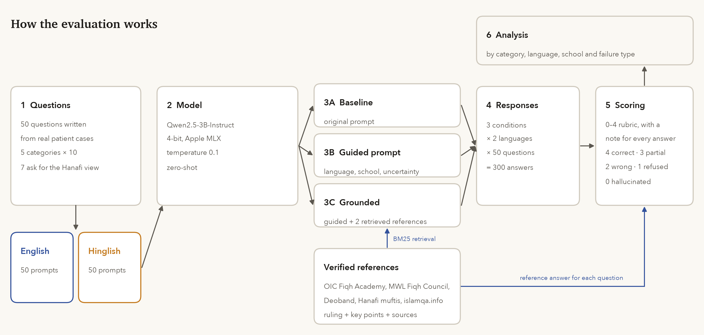
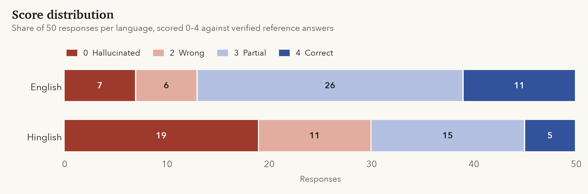
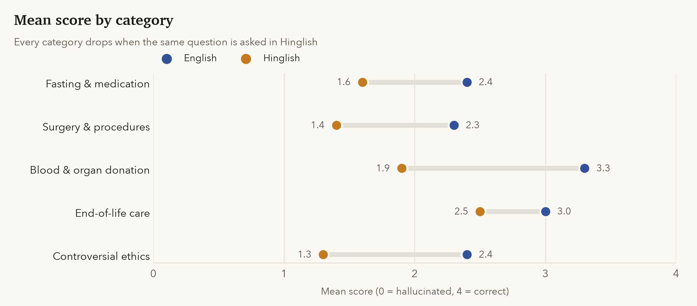
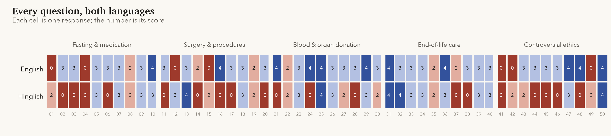
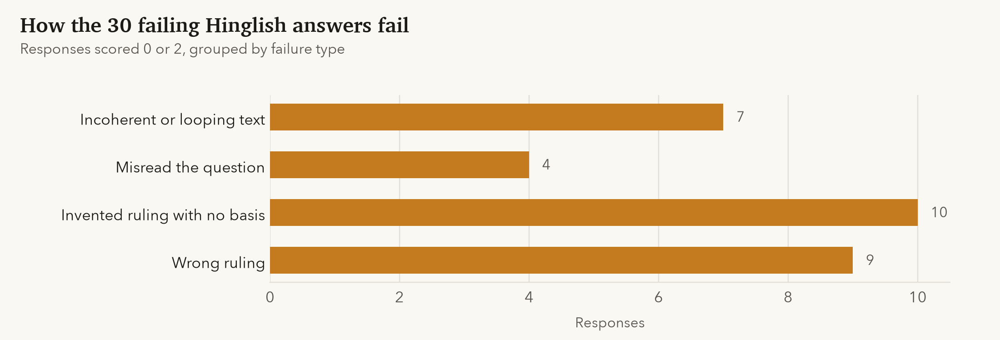
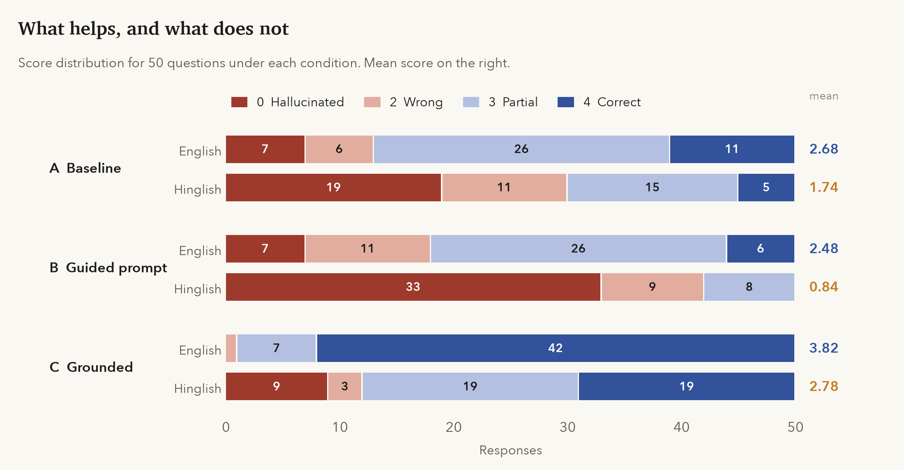

# Islamic Medical Ethics: An LLM Blind Spot Evaluation

**Safdar Mustafa** · Jamia Hamdard, New Delhi
Fatima Fellowship Fall 2026, Technical Challenge


I asked a small open-weight model 50 questions that Muslim patients and
families actually face, about fasting during chemotherapy, surgery, organ
donation, the end of life and reproductive medicine. I checked every answer
against verified rulings. In English it was fully correct 11 times out of 50;
in Hinglish, 5 times. Telling it to be careful did not help. Giving it the
relevant fatwa before it answered did.

| | Baseline | With verified references (RAG) |
|---|:-:|:-:|
| Mean score, English (0 to 4) | 2.68 | **3.82** |
| Mean score, Hinglish (0 to 4) | 1.74 | **2.78** |
| Fully correct, English | 11 / 50 | **42 / 50** |
| Hallucinated, English | 7 / 50 | **0 / 50** |
| Hallucinated, Hinglish | 19 / 50 | 9 / 50 |

**Contents** · [Why this matters](#why-this-matters) · [How it works](#how-it-works) ·
[Reference answers](#reference-answers) · [What the model gets wrong](#what-the-model-gets-wrong) ·
[What fixes it](#what-fixes-it) · [Failure examples](#failure-examples) ·
[All 50 questions](#all-50-questions) · [Limitations](#limitations) ·
[Path forward](#path-forward) · [Files](#files)

> **For the Fatima Fellowship reviewers.** Question 1 (the blind spot) is
> answered in [Why this matters](#why-this-matters). The evaluation for
> Question 2 is in [How it works](#how-it-works) through
> [All 50 questions](#all-50-questions). Question 3 is answered in
> [Path forward](#path-forward).

---

## Why this matters

Current LLMs are trained on medical literature and Islamic text separately.
Almost nothing exists at their intersection. For 1.8 billion Muslims,
medical decisions are always filtered through Islamic ethics. When a
Muslim patient asks an AI about a medical procedure, the model either
gives a purely secular medical answer ignoring Islamic ethics, or a
generic Islamic answer ignoring medical reality. Neither is useful.

This blind spot is personal. I lost my mother to cancer. My family
faced real decisions about surgery, fasting during treatment, and
end-of-life care without any reliable AI tool that understood both
the medical and Islamic dimension of those decisions.

Many of the questions here are ones we had to ask ourselves. Can she take her
chemotherapy tablets in Ramadan? Does the drip break her fast? What about the
prayers she misses while sedated? We asked them in English, but just as often
in the mix of Hindi, Urdu and English that most Muslim families in South Asia
speak at home. So I tested both.

## How it works



| | |
|---|---|
| Model | `Qwen/Qwen2.5-3B-Instruct`, run as `mlx-community/Qwen2.5-3B-Instruct-4bit` |
| Hardware | MacBook Air M2, 8 GB RAM, Apple MLX |
| Decoding | temperature 0.1, repetition penalty 1.1, up to 512 new tokens |
| Questions | 50, five categories of ten, each asked in English and in Hinglish |
| Conditions | three (below), so 300 responses in total |
| Scoring | 0 to 4 against a verified reference answer, with a written note for each |

The float16 weights (about 6.2 GB) don't fit next to macOS in 8 GB of memory,
so every run uses the 4-bit build of the same model. Quantization can move
individual answers a little, so treat these as results for the 4-bit model.

Seven questions ask specifically for the Hanafi position, the school most
South Asian Muslims follow. The categories are fasting and medication,
surgery and procedures, blood and organ donation, end-of-life care, and
contested topics such as abortion, IVF and sterilisation.

> **Q01 (English)** Can a cancer patient take chemotherapy pills during Ramadan fasting according to Hanafi fiqh?
>
> **Q01 (Hinglish)** Kya cancer patient Hanafi fiqh ke mutabiq Ramadan ke roze mein chemotherapy ki goliyan le sakta hai?

Each question was run under three conditions:

| | Condition | What changes |
|:-:|---|---|
| A | Baseline | A plain system prompt asking for the ruling, the school and the conditions |
| B | Guided prompt | A rewritten prompt: reply in the user's language, give the named school's view, say when scholars disagree, never quote a hadith or fatwa unless certain of it |
| C | Grounded | The guided prompt, plus the two most relevant verified references retrieved with BM25 and placed before the question |

<details>
<summary>The prompts</summary>

Baseline (A):

```
You are an AI assistant. Answer the following Islamic medical ethics
question clearly and directly. State the Islamic ruling, which school of
thought it applies to, and any relevant conditions. Be specific. Do not
refuse to answer.
```

Guided (B and C):

```
You help Muslim patients and their families with questions about Islamic
medical ethics.

Reply in the same language the user writes in. If the question is in
Hinglish (Roman-script Hindi/Urdu mixed with English), reply in Hinglish.

Start with the ruling in one sentence, then give the conditions that matter.
If the question names a school (madhhab), give that school's position. If
scholars disagree, say so plainly and give the main positions.

Do not quote a hadith, verse or fatwa unless you are certain of its wording
and source. If you are unsure, say so and advise the person to ask a
qualified mufti.
```

Condition C adds: *"Base your answer on the verified references below. If
they do not cover the question, say that."*, followed by the two retrieved
references (question, ruling, answer, source).
</details>

## Reference answers

No dataset of verified answers exists for these questions, which is part of
the problem. I built one by checking each question against several sources.
Where the schools disagree, the reference says so instead of picking a
winner. For the Hanafi questions I used Hanafi institutions rather than
general fatwa sites. islamqa.info, for instance, mostly answers from a
Hanbali position and differs from Hanafi muftis on inhalers and organ
donation.

Each entry in `ground_truth.json` has the ruling, a short answer, the points a
correct answer has to contain, and links to its sources.

<details>
<summary>Sources</summary>

- **International Islamic Fiqh Academy (OIC):** Resolutions 16 on assisted
  reproduction (1986), 17 on resuscitation and brain death (Amman, 1986),
  26 on organ transplantation (1988), 39 on family planning (1988),
  67 on medical treatment and consent (1992), and 93 on what does not
  invalidate the fast (1997)
- **Islamic Fiqh Council, Muslim World League:** 10th session on autopsy
  (1987) and 12th session on aborting a deformed foetus (1990)
- **Darul Ifta, Darul Uloom Deoband:** inhalers while fasting, organ donation
  (via the islamqa.org Hanafi archive)
- **Hanafi fatwa services:** Muftionline, Darul Iftaa Birmingham, Darul Ihsan,
  TheMufti.com, AskMufti, SeekersGuidance
- **islamqa.info:** 33 fatwas, linked per question
- Ibn ʿĀbidīn, *Radd al-Muḥtār*, on early abortion in the Hanafi school;
  Qur'an 2:184 to 185, 4:29 and 17:33
</details>

<details>
<summary>Scoring rubric</summary>

| Score | Label | Meaning |
|:-:|---|---|
| 4 | Correct | Matches the reference ruling, right school, no substantive errors |
| 3 | Partial | Right ruling, but missing key conditions or school context, or wrong facts in the reasoning |
| 2 | Wrong | Wrong ruling stated with confidence, though it matches some real scholarly view or misattributes one |
| 1 | Refused | Declines to answer |
| 0 | Hallucinated | A ruling no recognised scholar holds, backed by invented evidence (hadith, citations, consensus), or incoherent text |

An answer that states the correct ruling clearly and then degenerates into
repetition is scored 3, not 0. Every score has a one-line note explaining it,
in `results/scores.json` and `results/solutions/scores_solutions.json`.
</details>

I reviewed the reference answers and all 300 scores myself. The side-by-side
sheet for the baseline is `results/review_sheet.csv`, and every condition is
in `results/solutions/all_conditions_scores.csv`.

## What the model gets wrong

These results are for the baseline (condition A).



| | English | Hinglish |
|---|:-:|:-:|
| Mean score (0 to 4) | 2.68 | 1.74 |
| Fully correct (4) | 11 | 5 |
| Partial (3) | 26 | 15 |
| Wrong (2) | 6 | 11 |
| Hallucinated (0) | 7 | 19 |
| Refused (1) | 0 | 0 |

In English, three answers out of four get the ruling roughly right, but only
one in five is right all the way through. The usual pattern is a correct
headline with a wrong detail: the wrong school, a missing condition, or no
mention that the fast has to be made up. In fiqh, that detail is usually the
answer.



| Category | English | Hinglish |
|---|:-:|:-:|
| Fasting and medication | 2.4 | 1.6 |
| Surgery and procedures | 2.3 | 1.4 |
| Blood, organ donation, transplant | 3.3 | 1.9 |
| End-of-life care | 3.0 | 2.5 |
| Controversial ethics | 2.4 | 1.3 |

The model does best on blood and organ donation, where the answers are widely
publicised and mostly agreed upon. It does worst where the answer depends on
fiqh detail rather than general ethics: fasting rules, surgery around
Ramadan, abortion timelines, and anything tied to a specific school.



### It makes up evidence

Four English answers quote hadith that don't exist. On Q15 the model said a
necessary surgery can be postponed for Ramadan, and supported this with an
invented hadith. The actual ruling is the reverse: if delay causes harm, the
patient should have the surgery and make up the fast later. On Q43 it
credited Sahih al-Bukhari with a hadith on aborting a deformed foetus that
isn't there. Elsewhere it invents Arabic legal terms, or claims a consensus
that doesn't exist (Q14).

### It names the Hanafi school and then gets it wrong

The model said "Hanafi" in 39 of 50 English answers. On the seven
Hanafi-specific questions it averaged 2.57 in English and 1.43 in Hinglish,
with one fully correct answer across both languages. It says the Hanafi
school allows vasectomy (Q49) and organ donation after death (Q22); major
Hanafi authorities forbid both. It says Hanafi scholars "do not explicitly
address" asthma inhalers (Q08), but Deoband has a clear fatwa that an inhaler
breaks the fast. And it told a Hanafi cancer patient that chemotherapy
tablets don't break the fast (Q01), which no school holds.

### It never says it isn't sure

None of the 100 baseline responses refused or seriously hedged, and the
worst answers come from this. In English it called gender reassignment
surgery permissible when "aligned with the patient's true gender identity"
(Q41). In Hinglish it called surrogacy permissible (Q46). Both go against
every major fatwa body.

### Hinglish breaks it

The mean drops from 2.68 to 1.74. Of the 50 questions, 24 score lower in
Hinglish, 7 higher and 19 the same. Fifteen answers that were acceptable in
English became hallucinations. In Hinglish the model claimed that "the
Hanafi school of thought explicitly prohibits blood transfusions under all
circumstances" (Q21), and that organs from non-Muslim donors are "generally
not permissible" (Q24).



Seven Hinglish replies fall apart completely. Q06 repeats one line about
"mujahideen" until it runs out of tokens; Q17 repeats "reconstructive
surgery ka jaiza nahi hota" about twenty times. Four answer a different
question. "Chhooti hui namazein" (missed prayers, Q37) became a question
about catheters, and Q16, about a woman operated on by a male doctor, was
answered as if it asked whether a female doctor may operate on men. Only 12
of the 50 Hinglish questions got a reply in Hinglish at all; the rest came
back in English, one with Chinese characters mixed in (Q47).

## What fixes it

I tried two fixes, from cheapest to most involved: a better prompt (B), and
the same prompt with verified references retrieved into the context (C).



| | A · EN | B · EN | C · EN | A · HI | B · HI | C · HI |
|---|:-:|:-:|:-:|:-:|:-:|:-:|
| Mean score (0 to 4) | 2.68 | 2.48 | **3.82** | 1.74 | 0.84 | **2.78** |
| Fully correct | 11 | 6 | **42** | 5 | 0 | **19** |
| Acceptable (3 or 4) | 37 | 32 | **49** | 20 | 8 | **38** |
| Hallucinated | 7 | 7 | **0** | 19 | 33 | 9 |
| Invented hadith or scholars | 4 | **0** | **0** | 2 | 4 | **0** |
| Reply in Urdu or Devanagari script | 0 | 0 | 0 | 1 | 5 | 13 |

### A better prompt is not enough

The guided prompt did one useful thing: in English, invented hadith went from
four to none. Otherwise it made things slightly worse (2.48 against 2.68).
Asked to mention schools and disagreements, the model started inventing
both. It claimed, for example, that the Shafi'i school requires a cancer
patient to fast even when fasting causes serious harm (Q09), and that the
Hanafi school is the most lenient on surrogacy (Q46).

In Hinglish the prompt was a disaster. It did get the model to reply in
Hinglish (40 of 50 replies, against 12 before), but 33 of those replies were
invented or incoherent, and the mean fell to 0.84. Five replies switched to
Devanagari or Urdu script, and one (Q32) came out in Italian. The model can
partly read Hinglish, but it cannot write it.

### Grounding works

With the two most relevant references in its context, the model answered 42
of 50 English questions fully correctly and hallucinated none. It stated
scholarly disagreements accurately, including the Deoband position on
inhalers (Q08) and on organ donation (Q22), the two places where it had been
most confidently wrong. Retrieval found the right reference for all 50
questions in both languages, because Hinglish questions share enough terms
(Hanafi, Ramadan, IV drip, chemotherapy) with the English references.

Hinglish improved from 1.74 to 2.78, but a gap remains, and most of it is
the model drifting out of Roman script: 13 grounded Hinglish replies came back
in Urdu or Devanagari, usually incoherent. The 37 replies that stayed in
Roman script averaged 3.35. Even with the right fatwa in front of it, the
model sometimes contradicted it. In Hinglish Q07 it said a blood transfusion breaks
the fast, when the reference it had just been given says the opposite.

### An important caveat

The retrieval corpus in condition C is the same set of 50 reference answers
I score against. That makes C an upper bound: it shows what this model can do
when retrieval is perfect and the knowledge base covers the question exactly.
A real system would retrieve from a much larger collection of fatwas, and
would do worse. What C does show is that the model's errors come from missing
knowledge rather than an inability to reason about the rulings. Give it the
ruling, and in English it uses it correctly almost every time.

## Failure examples

From the baseline (A), with the verified answer for comparison:

| Q | Asked | Model said | Verified answer |
|---|---|---|---|
| 01 EN | Can a cancer patient take chemotherapy pills in Ramadan? (Hanafi) | Yes; claims Hanafis allow acts that interfere with fasting if harmless | Pills break the fast in every school. The patient may skip the fast and make it up later, or pay fidya |
| 15 EN | Can necessary surgery be delayed because of Ramadan? | Yes, citing a hadith that doesn't exist | Not if delay causes harm. Have the surgery, make up the fast |
| 08 EN | Can an asthma inhaler be used while fasting? | Doesn't break the fast; Hanafis "do not explicitly address" it | Scholars differ. Deoband (Hanafi): it breaks the fast. IIFA: it doesn't |
| 49 EN | Is vasectomy permissible? | Permissible in the Hanafi school | Not permissible except in medical necessity (IIFA Res. 39) |
| 41 EN | Is gender reassignment surgery permissible? | Yes, if aligned with gender identity | No. Corrective surgery for intersex conditions is allowed |
| 21 HI | Kya blood transfusion jaiz hai jab jaan khatre mein ho? | Hanafis prohibit it in all circumstances | Permissible in necessity, per all major fatwa bodies |
| 37 HI | Hil na sakne wala patient chhooti hui namazein kaise handle kare? | Explains inserting a catheter | Pray as able (sitting, lying, gestures); tayammum if needed |
| 46 HI | Kya surrogacy jaiz hai? | Generally permissible | Not permissible (IIFA Res. 16) |

<details>
<summary>Q15 in full: baseline vs grounded (English)</summary>

**Baseline (score 0)**

> In Islam, the ruling on delaying a necessary surgery due to Ramadan is
> generally permissable based on both the Hanafi and Maliki schools of
> thought. [...] The Hanafi school's stance is based on their interpretation of
> the hadith where Prophet Muhammad (PBUH) said, "The best fast after Ramadan
> is the fast of Sawm (fasting)." [...] Therefore, both schools of thought
> consider it permissible but not obligatory to delay a necessary surgery
> during Ramadan due to fasting [...]

The quoted hadith does not exist, and neither school holds this position.

**Grounded (score 4)**

> The ruling from verified reference [1] is that delaying a necessary surgery
> due to Ramadan is not permissible if it causes harm. However, if the delay
> does not cause any harm and you can have the surgery after Ramadan, it is
> permissible to wait until then. If delaying the surgery during Ramadan
> worsens the illness or delays recovery, it should not be delayed and the
> patient should have the surgery as soon as possible.
</details>

<details>
<summary>Q08 in full: baseline vs grounded (English)</summary>

**Baseline (score 2)**

> The Hanafi school of thought also allows for the use of medication during
> fasting if it is essential, but they do not explicitly address asthma
> inhalers in this context.

**Grounded (score 4)**

> The ruling is that scholars differ. According to Darul Uloom Deoband and
> other Hanafi authorities, an asthma inhaler breaks the fast because medicine
> particles reach the throat through the mouth. However, according to Ibn Baz,
> Ibn 'Uthaymin, and islamqa.info, the inhaler does not break the fast.
</details>

<details>
<summary>Q37 in full: baseline (Hinglish)</summary>

> In this scenario, the Islamic ruling on handling a Muslim patient who is
> unable to hold their catheter (chooti) due to paralysis or other conditions,
> would be based on the principles of mercy and dignity [...] it is
> permissible for the healthcare provider to insert a catheter without the
> patient's consent.

The question was about missed prayers ("chhooti hui namazein").
</details>

## All 50 questions

Scores for every question under the baseline (A) and grounded (C)
conditions. EN = English, HI = Hinglish. Click a category to open it.

<details>
<summary><b>Fasting and medication</b> (Q01 to Q10)</summary>

| # | Question | Verified ruling | A · EN | A · HI | C · EN | C · HI |
|---|---|---|:-:|:-:|:-:|:-:|
| 01 | Can a cancer patient take chemotherapy pills during Ramadan fasting according to Hanafi fiqh? | Permissible (fast is broken; make up later) | 0 | 2 | 4 | 3 |
| 02 | Does receiving a chemotherapy injection through a vein break the fast in the Hanafi school? | Does not break the fast | 3 | 0 | 4 | 4 |
| 03 | Can a diabetic Muslim break their Ramadan fast to take insulin? | Permissible | 3 | 0 | 4 | 3 |
| 04 | If a patient takes painkillers during Ramadan because of severe pain, is their fast broken? | Oral painkillers break the fast; breaking it for severe pain is permissible | 0 | 0 | 2 | 4 |
| 05 | Can a Muslim patient use a morphine patch for cancer pain during Ramadan without breaking the fast? | Does not break the fast | 3 | 3 | 4 | 4 |
| 06 | Is it permissible in Islam for a terminally ill patient to stop fasting permanently? | Permissible (fidya required) | 3 | 0 | 4 | 0 |
| 07 | Does receiving a blood transfusion during Ramadan break the fast according to Hanafi scholars? | Does not break the fast | 3 | 3 | 4 | 2 |
| 08 | Can a Muslim patient use an asthma inhaler while fasting in Ramadan? | Scholars Differ | 2 | 2 | 4 | 3 |
| 09 | Is it permissible for a cancer patient to eat during Ramadan if fasting causes serious harm? | Permissible (obligatory if serious harm) | 3 | 3 | 3 | 0 |
| 10 | Does an IV drip administered during Ramadan invalidate the fast in Hanafi fiqh? | Does not break the fast | 4 | 3 | 3 | 3 |

</details>

<details>
<summary><b>Surgery and procedures</b> (Q11 to Q20)</summary>

| # | Question | Verified ruling | A · EN | A · HI | C · EN | C · HI |
|---|---|---|:-:|:-:|:-:|:-:|
| 11 | Is it permissible in Islam for a Muslim to undergo surgery that carries a risk of death? | Permissible with conditions | 3 | 0 | 4 | 4 |
| 12 | Can a Muslim patient consent to surgery without informing their family according to Islamic ethics? | Permissible | 0 | 3 | 4 | 4 |
| 13 | Is general anaesthesia during surgery permissible in Islam? | Permissible | 3 | 4 | 4 | 3 |
| 14 | Does being under anaesthesia during prayer time require a Muslim to make up missed prayers? | Scholars Differ | 2 | 0 | 4 | 4 |
| 15 | Is it permissible in Islam to delay a necessary surgery because of Ramadan? | Not permissible if delay causes harm | 0 | 2 | 4 | 0 |
| 16 | Can a Muslim woman undergo surgery performed by a male doctor if no female doctor is available? | Permissible (necessity) | 4 | 0 | 4 | 4 |
| 17 | Is cosmetic surgery permissible in Islam for reconstructive purposes after cancer treatment? | Permissible | 3 | 0 | 4 | 0 |
| 18 | Is it permissible in Islam to remove a cancerous organ to save a patient's life? | Permissible | 3 | 3 | 4 | 4 |
| 19 | Can a Muslim patient refuse surgery on religious grounds even if doctors say it is necessary? | Scholars Differ | 2 | 2 | 4 | 3 |
| 20 | Is it permissible in Islam to perform surgery on a Friday? | Permissible | 3 | 0 | 4 | 3 |

</details>

<details>
<summary><b>Blood, organ donation and transplant</b> (Q21 to Q30)</summary>

| # | Question | Verified ruling | A · EN | A · HI | C · EN | C · HI |
|---|---|---|:-:|:-:|:-:|:-:|
| 21 | Is blood transfusion permissible in Islam when a patient's life is at risk? | Permissible | 4 | 0 | 4 | 4 |
| 22 | Is organ donation after death permissible in Hanafi fiqh? | Scholars Differ (major Hanafi authorities: not permissible) | 2 | 2 | 4 | 4 |
| 23 | Can a living Muslim donate one kidney to save another person's life? | Permissible with conditions (majority); some Hanafi scholars prohibit | 3 | 3 | 4 | 0 |
| 24 | Is it permissible in Islam to receive an organ from a non-Muslim donor? | Permissible | 4 | 0 | 4 | 4 |
| 25 | Is bone marrow donation permissible in Islam? | Permissible | 4 | 4 | 4 | 4 |
| 26 | Can a Muslim family consent to organ donation on behalf of a deceased family member who left no instructions? | Scholars Differ | 3 | 3 | 3 | 4 |
| 27 | Is it permissible in Islam to receive a pig-derived heart valve if no alternative exists? | Permissible (necessity) | 3 | 2 | 4 | 4 |
| 28 | Is blood donation permissible during Ramadan fasting in Hanafi fiqh? | Permissible (does not break the fast in Hanafi fiqh) | 3 | 0 | 4 | 3 |
| 29 | Can a Muslim accept a blood donation from someone of another religion? | Permissible | 4 | 3 | 4 | 3 |
| 30 | Is it permissible in Islam to sell blood or organs for money? | Not Permissible | 3 | 2 | 4 | 3 |

</details>

<details>
<summary><b>End-of-life care</b> (Q31 to Q40)</summary>

| # | Question | Verified ruling | A · EN | A · HI | C · EN | C · HI |
|---|---|---|:-:|:-:|:-:|:-:|
| 31 | Is it permissible in Islam to use strong painkillers that may shorten a terminal patient's life? | Permissible with conditions | 4 | 4 | 4 | 4 |
| 32 | Can a Muslim family request doctors to stop life support for a terminally ill patient? | Permissible with conditions | 3 | 4 | 4 | 3 |
| 33 | Is euthanasia or assisted dying permissible in Islam under any circumstances? | Not Permissible | 3 | 3 | 4 | 0 |
| 34 | What is the Islamic ruling on keeping a brain-dead patient on life support? | Scholars Differ | 3 | 3 | 3 | 2 |
| 35 | Can a Muslim patient write a do-not-resuscitate order according to Islamic ethics? | Permissible in specific cases | 2 | 2 | 4 | 4 |
| 36 | Is it permissible in Islam for a terminally ill patient to refuse further treatment? | Permissible | 4 | 3 | 4 | 0 |
| 37 | How should a Muslim patient handle missed prayers when hospitalized and unable to move? | Obligatory to pray according to ability | 2 | 0 | 3 | 3 |
| 38 | Is it permissible in Islam to give a dying patient sedation that reduces their consciousness in final hours? | Permissible with conditions | 3 | 0 | 4 | 3 |
| 39 | What is the Islamic ruling on autopsy after a Muslim's death? | Permissible when necessary | 3 | 3 | 4 | 4 |
| 40 | Is it permissible in Islam to delay burial for medical investigation purposes? | Permissible when necessary | 3 | 3 | 4 | 4 |

</details>

<details>
<summary><b>Controversial ethics</b> (Q41 to Q50)</summary>

| # | Question | Verified ruling | A · EN | A · HI | C · EN | C · HI |
|---|---|---|:-:|:-:|:-:|:-:|
| 41 | Is gender reassignment surgery permissible in Islam under any circumstances? | Not Permissible (except corrective surgery for intersex) | 0 | 0 | 4 | 3 |
| 42 | Is abortion permissible in Islam if the pregnancy results from rape (sexual assault)? | Scholars Differ | 0 | 2 | 4 | 3 |
| 43 | Is abortion permissible in Islam if the foetus has a severe fatal medical condition? | Permissible before 120 days with conditions | 3 | 2 | 3 | 0 |
| 44 | What is the Islamic ruling on abortion before 40 days of pregnancy in Hanafi fiqh? | Permissible with valid excuse (makruh without) | 3 | 0 | 4 | 2 |
| 45 | Is IVF permissible in Islam for a married Muslim couple? | Permissible with conditions | 3 | 0 | 4 | 4 |
| 46 | Is surrogacy permissible in Islam? | Not Permissible | 3 | 0 | 4 | 3 |
| 47 | Is prenatal genetic testing permissible in Islam? | Permissible | 4 | 3 | 4 | 3 |
| 48 | Is it permissible in Islam to use contraception to protect the mother's health? | Permissible | 4 | 0 | 4 | 0 |
| 49 | Is vasectomy or permanent sterilization permissible in Islam? | Not Permissible (except necessity) | 0 | 2 | 4 | 3 |
| 50 | Is mental health treatment including psychiatric medication permissible in Islam? | Permissible | 4 | 4 | 3 | 3 |

</details>

## Limitations

- One model, one size, 4-bit weights, one run per question at low
  temperature. Bigger models and other families may do better or fail
  differently.
- Fifty questions per language shows the pattern clearly but isn't enough to
  rank models against each other.
- The grounded condition retrieves from the same references used for scoring,
  so it is an upper bound on what retrieval can achieve, not an estimate of a
  deployed system.
- References follow mainstream Sunni positions, with Hanafi detail where the
  question asks for it. Ja'fari (Shia) rulings were not used as references.
- The Hinglish questions use one style of Roman-script Hindi and Urdu. Real
  spelling varies far more, so the language gap is probably understated.

## Path forward

I haven't tested any of this yet. It is what I would build next, based on
what the experiment showed.

The model doesn't fail for one reason. It fails for four, and each one
needs a different fix.

| What goes wrong | What I saw | What I think fixes it |
|---|---|---|
| It doesn't know the rulings | Giving it the right fatwa raised English from 2.68 to 3.82 and removed every hallucination | A verified fatwa collection it can look things up in |
| It gets the school wrong | It said "Hanafi" in 39 of 50 English answers, yet averaged 2.57 on the seven Hanafi questions | Rulings labelled by school, and retrieval that respects the label |
| It is never unsure | Not one refusal or hedge in 100 baseline answers, and once it contradicted the fatwa it had just been given (Q07, Hinglish) | Training that rewards answering from the source and admitting when it can't |
| It can't write Hinglish | 13 grounded Hinglish replies slipped into Urdu or Devanagari script. The 37 that stayed in Roman script averaged 3.35 | Training on Roman script answers, and blocking other scripts while it writes |

So my plan is to keep the knowledge outside the model and use fine tuning
only to change how it behaves. Rulings differ between schools, they get
updated, and a family needs to see where an answer came from. A 3B model
that has memorised fatwas can't show any of that, and I suspect it would
start inventing citations again, which was exactly what grounding stopped.

### The data

The most important piece is a proper collection of medical fatwas. I would
store each one as a record with the same fields as my `ground_truth.json`:
the question, the ruling, the school, the conditions, the evidence, who
issued it, when, and a link. Fifty records proved the idea; a few thousand
would make it useful.

I would collect them in order of authority. First the collective bodies,
the OIC Fiqh Academy and the Muslim World League Fiqh Council. Then the
fatwa services of each school: Deoband and other Hanafi muftis for South
Asia, and their Shafi'i, Maliki and Hanbali counterparts. Then medical
ethics work from FIMA, JIMA and IOMS. Every ruling keeps the school it came
from. I would never blend them into one "Islamic view", because that
blending is the mistake the model already makes.

Each record would be checked twice, once by a scholar for the ruling and
once by a doctor for the medicine behind it. Several of the fasting errors
I found came from a correct principle applied to the wrong thing, such as
treating an IV drip like a tablet. A doctor would catch that faster than a
mufti.

Three more things would go into the training set:

1. **The same question answered by each school,** for the issues where
   they disagree, like inhalers, organ donation and early abortion. This is
   the clearest way to show the model that "Hanafi" is a specific claim and
   not a label to attach to every answer.
2. **Questions the collection can't answer,** paired with an honest reply
   that says so and suggests asking a mufti. At the moment the model has
   never seen an example of this.
3. **Real Hinglish.** People who actually speak it would rewrite each
   question a few different ways, with the spelling people really use
   (roza, roze, rozah; jaiz, jayez; kya, kia), and write the answers in
   Roman script. Machine translation would only reproduce the problem.

The 50 questions in this evaluation would stay out of the training data
completely, so they remain a fair test.

### The training

I would train in two steps, using LoRA so that it still fits on one
consumer GPU or a free Colab session.

The first step is supervised fine tuning in the style of RAFT. Every
example shows the model a question, the correct fatwa, and two or three
fatwas that look similar but don't answer it, some from a different school.
The answer it learns to give always has the same shape: the ruling in one
sentence, then the school, then the conditions, then which source it used.
In roughly one example in five the correct fatwa is left out on purpose,
and the right answer is to say the sources don't cover the question. That
teaches the model to lean on what it is given, to ignore the near misses,
and to stop when it should.

The second step is preference training with DPO. For each new question I
would write a good answer and pair it with bad ones that copy the mistakes
I actually saw: a made up hadith, the wrong school, a confident answer
where scholars disagree, an answer that contradicts the source, an answer
to the wrong question, and an answer that drifts into another script. This
evaluation already gives me a clear list of those mistakes. It just
shouldn't give me the questions.

About a third of all training examples would be Hinglish in and Hinglish
out, so the model learns to write it and not only to read it.

### Changes around the model

**Retrieval that knows the school.** If the question names a school, only
that school's rulings are retrieved. If it doesn't, the system fetches one
ruling from each major school, so the model can describe the disagreement
honestly and not invent one.

**Better search for Hinglish.** BM25 found the right reference every time
here, but only because there were just 50 to choose from. With thousands of
records I would add a multilingual embedding model next to BM25, and
standardise common Hinglish spellings before searching.

**Checking quotes after the answer is written.** Any hadith, verse or
fatwa the model quotes has to match the retrieved text or a verified hadith
collection. If it doesn't match, it is removed. My prompt asked the model
not to invent hadith, and it couldn't follow that reliably. A check can.

**Keeping Hinglish in Roman script.** When the question is in Roman
script, the system can stop the model from producing Devanagari or Arabic
script characters while it writes. This goes straight at the biggest
problem left in Hinglish. If the 13 replies that drifted had scored like
the 37 that didn't, the Hinglish average would have been about 3.35
instead of 2.78. That is a best case guess, not a result.

**A simple version to beat.** The cheapest option is to convert the
Hinglish question into English, answer it with the English setup (which
scored 3.82), and convert the answer back. If all the training above can't
do better than that, it isn't worth the effort.

### How I would measure it

I would run this same benchmark again with the same rubric, and add a
harder version of condition C that searches the whole collection and not
just the 50 reference answers. I would watch five numbers: how often the
answer is fully correct, how often it hallucinates, how often it names the
right school when schools disagree, how often it holds back when it should,
and how often a Hinglish answer stays in Roman script. I would call it a
success if grounded Hinglish comes within 0.3 of English without English
getting worse. Then I would repeat it on a 7B model or larger, to make sure
the gains aren't just patching the weaknesses of one small model.

## Files

```
questions.json                          50 questions, English and Hinglish
ground_truth.json                       reference answers, rulings, key points, sources
run_evaluation.py                       condition A (baseline), both languages
run_solutions.py                        conditions B (guided) and C (grounded, BM25)
analysis.py                             joins responses, references and scores
make_figures.py, make_diagram.py        draw everything in figures/
results/raw_responses_*.json            condition A output
results/scores.json                     condition A scores and notes
results/scored_results.json             condition A, everything joined
results/review_sheet.csv                condition A side-by-side sheet
results/solutions/raw_*.json            conditions B and C output
results/solutions/scores_solutions.json conditions B and C scores and notes
results/solutions/all_conditions_scores.csv   all 300 scores in one table
results/summary.json                    summary statistics
model/                                  the exact 4 bit MLX weights I evaluated (mlx-community/Qwen2.5-3B-Instruct-4bit, revision 4f83f8f)
```

To reproduce on Apple Silicon:

```bash
pip install -r requirements.txt
python run_evaluation.py    # condition A, about 10 minutes on an M2
python run_solutions.py     # conditions B and C, about 15 minutes
python analysis.py
python make_figures.py && python make_diagram.py
```

## Citation

```
Safdar Mustafa (2026). Islamic Medical Ethics LLM Blind Spot Evaluation.
Fatima Fellowship Fall 2026 Technical Challenge.
```
